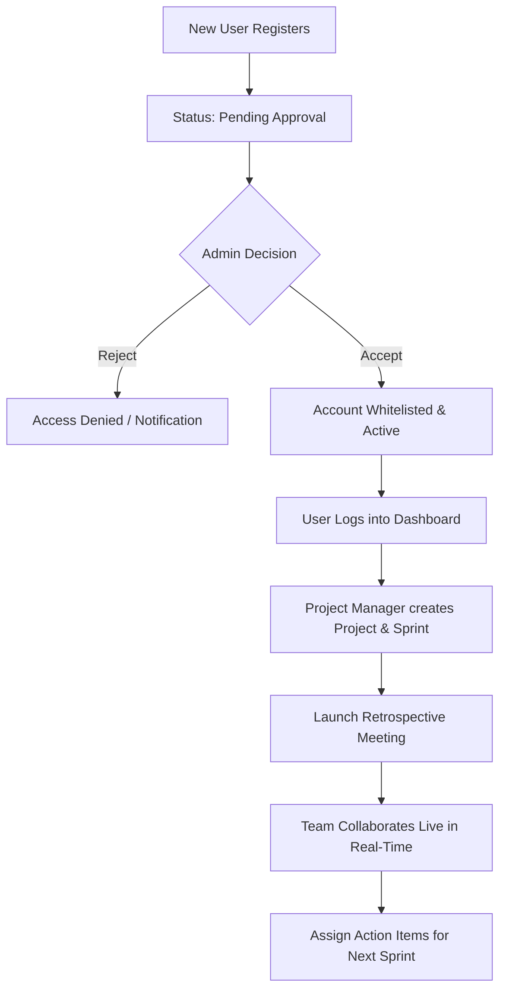

# 🚀 RetroFlow — Complete User & Workflow Guide
*A Short, Simple, and Step-by-Step Guide for New Users & Administrators*

---

## 📌 1. Overview & User Roles

**RetroFlow** is a real-time collaborative Agile Retrospective and Sprint Management platform.

### User Roles & Hierarchy
| Role | Permissions & Access |
| :--- | :--- |
| **Workspace Admin** | Full access: Approves/rejects registrations, manages workspace settings, creates projects, deletes projects. |
| **Project Lead / Manager** | Manages specific projects, starts/ends sprints, launches retrospectives, assigns team members. |
| **Developer / QA / DevOps** | Adds feedback cards, votes on topics, tracks sprint progress and action items. |
| **External Contributor (Guest)** | Joins a live retro via invite link/email to share thoughts without polluting workspace directory. |

---

## 🔄 2. Complete Workflow Step-by-Step

---

## 📝 3. Detailed Walkthrough

### Step 1: Sign Up & Registration
1. User navigates to the **Sign Up** page.
2. Registers using **Email & Password** or **Google OAuth**.
3. **Security Gate:** By default, new accounts are in **Pending Approval** state to ensure only verified team members access company sprint data.

---

### Step 2: Admin Approval (Accept / Reject)
1. **Admin logs in** and opens **Dashboard ➔ Team Members Tab**.
2. Under **Registration Requests / Pending Approval**:
   - Click **`Accept`**: User is instantly whitelisted, assigned a role (e.g. Developer), and receives an automated confirmation email via Brevo.
   - Click **`Reject`**: Registration request is dismissed.
3. Once accepted, the user can log in immediately.

---

### Step 3: Project Setup & Team Assignment
1. **Create Project:** Click **`Create Project`**, choose a project name (e.g., *Ezytix*), Key (`EZY`), and assign a Project Lead.
2. **Assign Members:** In **Project ➔ Team & Settings**:
   - Click **`Invite Team Member`** to add registered colleagues.
   - Select their project role (*Developer, QA, DevOps, Manager*).
   - If a member leaves the initiative, click **`Remove`** (confirmed via a sleek, clean modal).
3. **General Configuration:**
   - Toggle **`Enable Monthly Automated Retrospective`** to automatically open a fresh board on the 1st of every month, or keep it manual.
   - Click **`Save Configuration`** to save changes with instant visual button and toast feedback.

---

### Step 4: Sprints & Retrospectives
1. **Sprint Management:**
   - Under **Sprints & Backlog**, create Sprints (e.g., *Sprint 1: Jan 1 - Jan 15*).
   - View active sprint metrics: **Sprint Timeline**, **Task Progress**, and **Team Roster**.
2. **Retrospective Types:**
   - **Automated Monthly Retro:** Scheduled automatically for regular cadence.
   - **Custom Sprint Retro:** Created anytime on-demand with customized columns and timing.

---

### Step 5: Live Collaborative Retrospective Session
1. **Invite Participants:**
   - Click **`Share Invite`** to copy the secure session link or send direct Brevo email invitations to both internal teammates and external guest reviewers.
2. **Real-Time Board Interaction (Socket.io):**
   - **Add Cards:** Post thoughts under *What Went Well*, *Needs Improvement*, or *Action Items*. New cards appear smoothly for all participants without page refresh.
   - **Live Voting:** Upvote key issues to prioritize discussion topics.
   - **Instant Deletion:** If you wish to delete a card, click the trash icon for a quick inline `Delete? [Yes] [✕]` confirmation. It instantly vanishes across all screens.
3. **Action Items Assignment:**
   - Towards the end of the retrospective meeting, prioritize identified improvements into **Action Items**.
   - Assign each action item to an owner with a clear due date to guarantee accountability before the next sprint begins.

---

## 💡 Quick Tips for New Users
- **Hard Refresh:** If you ever update icons or settings and want to see instant browser cache clearance, press **`Ctrl + Shift + R`** (Windows/Linux) or **`Cmd + Shift + R`** (Mac).
- **External Guests:** External contributors joining via email invite can share thoughts freely without cluttering your core workspace team directory.
- **Real-Time Presence:** No manual page refresh is needed during live retros; all cards, votes, and status changes sync live across all connected devices.

---

*RetroFlow Documentation — Updated October 2026*
